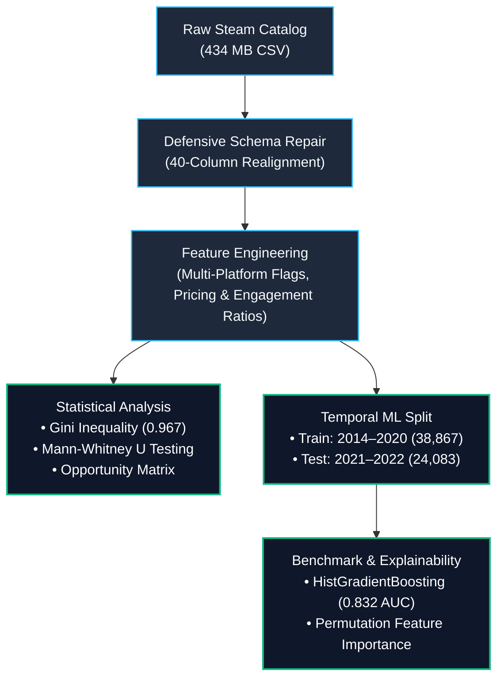
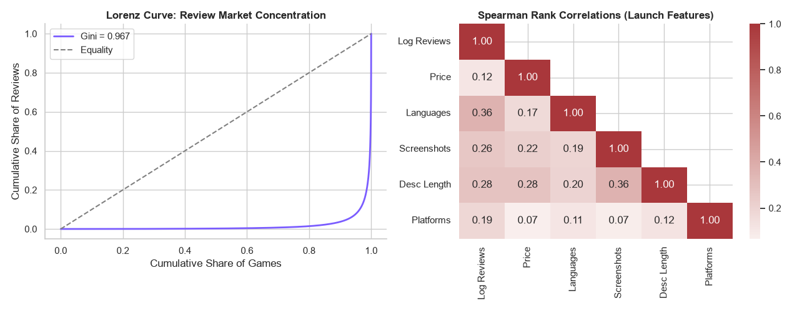
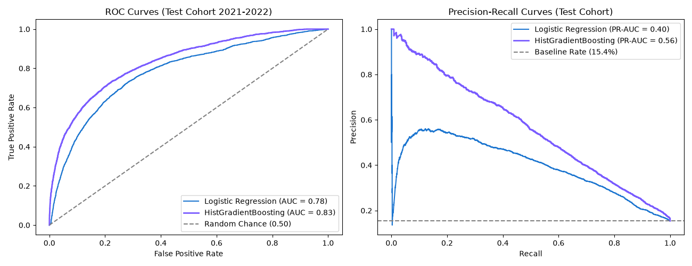

# 🎮 Steam Market Intelligence: Commercial Traction Prediction & Non-Parametric Modeling

[](https://www.python.org/)
[](https://scikit-learn.org/)
[](https://pandas.pydata.org/)
[]()

## 📌 Executive Summary
With over **130,000 titles** listed on Steam, platform discovery is saturated. Nearly **34% of all games have zero reviews**, and over **81% fail to reach commercial traction** (defined as $\ge 100$ user reviews). For indie developers, publishers, and investment funds, allocating development capital without empirical demand validation represents extreme downside risk.

This project implements an end-to-end quantitative analytics and predictive machine learning pipeline on a **414 MB dataset (130,100 listings)** to:
1. **Uncover platform inequality and consumer behavior** using non-parametric statistics (Mann-Whitney U, Gini concentration, Chi-Square odds ratios).
2. **Identify market demand vs. supply mismatches** across primary genres.
3. **Predict commercial traction before launch** using only pre-release signals via temporal out-of-time benchmarking, achieving a **4.15x Lift** in hit discovery.

---

## 📊 Key Findings at a Glance

* **Extreme Winner-Take-Most Dynamic:** Review engagement displays a **Gini coefficient of 0.967**. The top **1% of titles capture 74.9% of all platform reviews**, while the bottom 80% struggle for visibility.
* **The Indie & Casual Saturation Trap:**
  * **Indie:** 70.3% of catalog supply captures only 46.3% of market demand (**0.66x Demand/Supply ratio**).
  * **Casual:** 43.1% of supply captures just 18.4% of demand (**0.43x Demand/Supply ratio**, with a 15.2% hit rate).
  * **High-Leverage Niches:** **MMO (5.79x)**, **Action (1.63x)**, and **RPG (1.48x)** show significant organic excess demand relative to listing volumes.
* **The Multi-Platform Multiplier:** Supporting macOS or Linux alongside Windows raises the 100-review traction rate from 22.2% to 37.5%—an **Odds Ratio of 2.10** ($p < 10^{-300}$).
* **Pre-Launch Predictive Power:** Using strictly launch-time attributes (localization depth, achievements, media count, cloud integration), **Histogram Gradient Boosting** achieved an **ROC-AUC of 0.832** and **PR-AUC of 0.563** (vs. a 15.4% random baseline), delivering **64.0% Precision at the Top 10% cutoff**.

---
### 🛠 Data Architecture & Defensive Pipeline



### Data Quality & Structural Fixes
* **CSV Schema Realignment:** Resolved an unindexed schema shift where an unquoted `DiscountDLC count` in raw rows caused field corruption past the `Price` column.
* **Catalog Inactivity Screening:** Filtered non-commercial records, demos, and internal playtests (19.56% `"0 - 0"` estimated owners; 100% missing `Movies` media data).
* **Mature Cohort Selection:** Evaluated on the 2014–2022 release window ($N = 62,950$) to guarantee fair post-launch review maturation without survival bias.

---

## 📈 Exploratory & Statistical Rigor

### 1. Market Concentration (Lorenz Curve)
Because review volume exhibits severe leptokurtosis ($\text{Skewness} = +175.21$, $\text{Kurtosis} = 44,177.10$), standard parametric statistics ($t$-tests, standard deviations) fail. We evaluated engagement using the
**Lorenz Curve**:
$$\text{Gini} = 1 - 2 \int_0^1 L(p) \, dp = 0.967$$


### 2. Hypothesis Testing Results
* **Paid vs. Free-to-Play Mechanics:**
  * *Test:* Two-sided Mann-Whitney U test on review volumes.
  * *Result:* $U = 1.34 \times 10^{-154}$, **Probability of Superiority = 0.421** for free games. Paid games maintain higher median sustained engagement than uncurated free titles.
* **Platform Reach Impact:**
  * *Contingency Analysis:* Multi-platform releases ($\ge 2$ OS) vs. Single-platform (Windows-only).
  * *Odds Ratio:* **2.10** ($95\%\text{ CI: } [2.02, 2.18]$, $\chi^2 = 8.20 \times 10^{-308}$).

---

## 🤖 Predictive Machine Learning Benchmark

### Problem Framing
Predict whether a proposed game listing will achieve **Commercial Traction ($\ge 100$ total reviews)** using **strictly pre-launch attributes** available prior to Day 1.

### Temporal Holdout Design
To avoid temporal data leakage:
* **Training Set:** Releases from **2014 to 2020** ($N = 38,867$, Hit Rate = 32.4%)
* **Testing Set:** Releases from **2021 to 2022** ($N = 24,083$, Hit Rate = 15.4%)

### Model Comparison

| Model | ROC-AUC | PR-AUC (Baseline: 0.154) | Precision @ Top 10% | Lift @ Top 10% |
| :--- | :---: | :---: | :---: | :---: |
| **Logistic Regression (L2)** | 0.780 | 0.397 | 49.7% | 3.22x |
| **HistGradientBoosting** | **0.832** | **0.563** | **64.0%** | **4.15x** |



### Feature Importance Drivers (Permutation Importance on Test Set)
1. **`n_languages` ($+0.0830 \pm 0.0028$):** The primary determinant. Multi-language localization expands total addressable market (TAM) across Asian and European storefronts.
2. **`n_achievements` ($+0.0284 \pm 0.0020$):** Strong proxy for completionist gameplay loops and progression design.
3. **`has_steam_cloud` ($+0.0230 \pm 0.0003$):** Direct marker of production budget, quality assurance, and Steam Deck verification readiness.
4. **`desc_len` ($+0.0134 \pm 0.0006$):** Store page copy investment and narrative presentation depth.
5. **`n_screenshots` ($+0.0123 \pm 0.0008$):** Visual richness on the store front driving wishlist conversions.

---

## 💡 Strategic Takeaways for Game Studios & Publishers

1. **Avoid the Uncurated Casual/Indie Trap:** Building a 2D casual platformer or puzzle game places you in direct competition with 70% of the catalog for less than 19% of platform review demand. Focus capital on higher-demand genres (Action, RPG, Simulation).
2. **Prioritize Localization Over Marketing Spend:** Translating store pages and text into 5+ core languages (Simplified Chinese, Japanese, German, Russian, Spanish) yields higher traction lift than increasing asset screenshot counts.
3. **Mandate Platform Features Early:** Integrating Steam Cloud, achievements, and Linux/Proton compatibility early costs minimal developer hours relative to the $2.10\times$ odds multiplier it provides.

---

## 💻 Repository Structure & Reproducibility

### 🗂 Repository Structure & Reproducibility

| File | Type | Description |
| :--- | :--- | :--- |
| `steam_eda.py` | Python Script | Data auditing, 40-col schema repair, non-parametric tests, and Lorenz curve generation |
| `steam_ml_benchmark.py` | Python Script | Feature engineering, temporal split, and HistGradientBoosting ROC/PR pipeline |
| `steam_model_benchmark.png` | Asset | Evaluation visualizations (ROC-AUC, Precision-Recall, Permutation Importance) |
| `README.md` | Documentation | Executive case study, economic takeaways, and reproducibility specifications |

  ### Quickstart

  ```bash
  # 1. Clone repository
 git clone https://github.com/AshutoshTembhekar/steam-market-intelligence.git
  cd steam-market-intelligence

 # 2. Install dependencies
  pip install pandas numpy scipy matplotlib seaborn scikit-learn

  # 3. Run exploratory data analysis & statistical tests
  python steam_eda.py

  # 4. Run machine learning benchmark
  python steam_ml_benchmark.py
  ```

Dependencies
python >= 3.10

pandas, numpy, scipy

scikit-learn

matplotlib, seaborn

👤 Author

Ashutosh Dhananjay Tembhekar

Data Analytics Specialist
